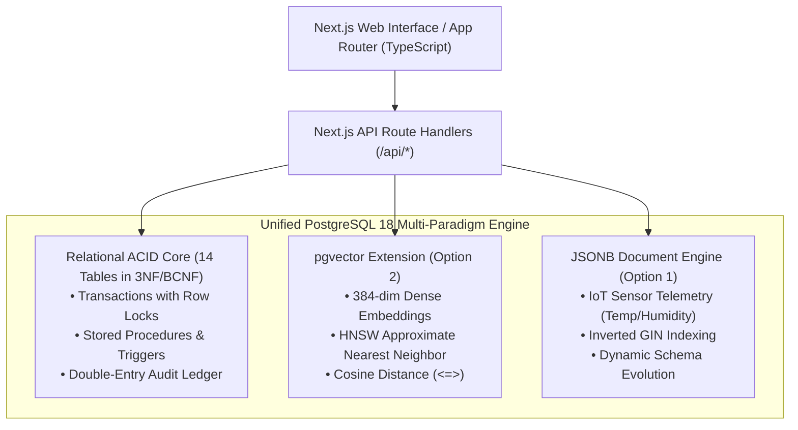

# Autonomous Smart Inventory & Supply Chain Intelligence System (SIMS)

[](https://nextjs.org/)
[](https://www.postgresql.org/)
[](https://github.com/pgvector/pgvector)
[](https://tailwindcss.com/)
[](https://opensource.org/licenses/MIT)

**Course:** Database Management Systems (DBMS Experiential Learning – Level 3 Project)  
**Institution:** PES University  
**Faculty In-Charge:** Dr. Nagasundari S  
**GitHub Repository:** [https://github.com/nandankumarkr/smart-inventory](https://github.com/nandankumarkr/smart-inventory)

---

## 🌟 Executive Overview

The **Smart Inventory Management System (SIMS)** is a full-stack, enterprise-grade inventory intelligence platform designed to eliminate phantom reads, stockout race conditions, and perishable lot spoilage in multi-facility supply chains.

Moving beyond simple CRUD applications, SIMS implements:
1. **Double-Entry Relational Stock Ledger:** Guarantees strict non-repudiation and traceability of every physical unit moved across distribution hubs.
2. **ACID Inter-Warehouse Transfers:** Employs row-level locking (`SELECT ... FOR UPDATE`) in stored procedures to prevent concurrent over-depletion.
3. **Automated FIFO & Expiry Picking:** Uses stored procedures to automatically allocate batches ordered by earliest expiration date first.
4. **AI Semantic Vector Catalog Search:** Uses PostgreSQL with the `pgvector` extension (Option 2) to match natural language queries against 384-dimensional dense vectors using Cosine Distance (`<=>`) and HNSW approximate nearest neighbor indexing.
5. **NoSQL IoT Environmental Telemetry:** Leverages PostgreSQL's semi-structured `JSONB` engine (Option 1) with GIN indexing to ingest cold-chain sensor streams (temperature, humidity, vibration).

---

## 👥 Team Formation & Contributions (2-Member Team)

| Team Member | Primary Role | Key Responsibilities & Contributions |
| :--- | :--- | :--- |
| **Nandan Kumar** | Lead Database Architect & Backend Engineer | • Entity-Relationship (ER) modeling and relational normalization (3NF/BCNF).<br>• DDL scripts (`01_schema_ddl.sql`) with PK, FK, and CHECK constraints.<br>• Stored procedures (`sp_execute_stock_transfer`, `sp_fulfill_order_fifo`).<br>• Row-level triggers (`trg_prevent_negative_inventory`, `trg_audit_products_changes`).<br>• Next.js Server Action API handlers with database connection pooling (`pg`). |
| **Team Member 2** | Full-Stack UI & Vector Data Specialist | • `pgvector` vector embedding ingestion & HNSW indexing (`02_indexes_and_views.sql`).<br>• Next.js 14 responsive web interface with Tailwind CSS and Lucide icons.<br>• Role-Based Access Control (Admin, Manager, Staff, Auditor) UI switcher.<br>• Complex DML analytical queries (`05_complex_queries.sql`) with JOINs, GROUP BY, HAVING, and window functions.<br>• Project report and test case documentation. |

---

## 🏛️ Multi-Paradigm Database Architecture

The system satisfies both **Option 2 (SQL + Vector Database)** and **Option 1 (NoSQL Semi-Structured Data)**:



---

## 🎯 Advanced Database Features (Rubric Section 7)

SIMS implements all required advanced database features:

| Advanced Feature | Implemented Artifact | Purpose / Real-World Functionality |
| :--- | :--- | :--- |
| **1. Transactions (ACID)** | `sp_execute_stock_transfer` | Atomically relocates stock between warehouses using `SELECT ... FOR UPDATE` row locks, rolling back if source inventory is insufficient. |
| **2. Database Views** | `vw_low_stock_alerts`<br>`vw_inventory_valuation_fifo`<br>`vw_supplier_scorecard`<br>`vw_expiring_batches_forecast` | Live aggregation comparing physical stock against safety levels, FIFO financial asset valuation, and vendor SLA scorecards. |
| **3. Stored Procedures** | `sp_fulfill_order_fifo`<br>`sp_execute_stock_transfer` | Automates FIFO lot picking by oldest expiration date, updating ledger snapshots in an append-only transaction journal. |
| **4. Database Triggers** | `trg_prevent_negative_inventory`<br>`trg_audit_products_changes`<br>`trg_update_warehouse_occupancy` | Enforces kernel-level prevention of negative inventory, change data capture (CDC) in JSONB, and dynamic warehouse volume recalculation. |
| **5. Vector Search** | `product_embeddings` (HNSW) | Natural language conceptual product search using `pgvector` cosine similarity (`1 - (embedding <=> target)`). |
| **6. NoSQL Aggregation** | `warehouse_telemetry` (JSONB) | GIN-indexed IoT cold chain monitoring querying JSON containment (`@>`) and aggregating abnormal temperature spikes. |

---

## 📂 Project Directory Structure

```text
smart-inventory/
├── database/
│   ├── 01_schema_ddl.sql             # Relational DDL (14 tables, PKs, FKs, CHECK constraints)
│   ├── 02_indexes_and_views.sql      # B-tree, Composite, GIN, HNSW indexes & 4 Views
│   ├── 03_triggers_and_procedures.sql # Stored procedures (FIFO, Transfer) & Triggers (CDC, checks)
│   ├── 04_seed_data.sql              # Realistic seed data across all facilities
│   ├── 05_complex_queries.sql        # JOIN, GROUP BY, HAVING, Window Functions, CTEs
│   ├── 06_vector_and_nosql.sql       # pgvector cosine similarity & JSONB queries
│   └── init_db.ps1 / init_db.sh      # Automated one-click database initialization
├── src/
│   ├── app/
│   │   ├── dashboard/page.tsx        # Executive KPIs, stockout alerts & warehouse occupancy
│   │   ├── inventory/page.tsx        # Master catalog & FIFO batch inspector modal
│   │   ├── semantic-search/page.tsx  # Natural language AI vector search demo
│   │   ├── transfers/page.tsx        # ACID inter-warehouse transfer interface
│   │   ├── purchase-orders/page.tsx  # Procurement lifecycle & batch receiving
│   │   ├── suppliers/page.tsx        # Vendor scorecard & SLA metrics
│   │   ├── dbms-evaluator/page.tsx   # Interactive live query visualizer for viva/grading
│   │   ├── er-diagram/page.tsx       # Built-in relational schema & normalization viewer
│   │   ├── layout.tsx                # App shell with Sidebar, Header & RBAC selector
│   │   └── page.tsx                  # Project overview & architectural pillars
│   ├── components/                   # UI components (Sidebar, Header, StatCards)
│   └── lib/                          # Database connection pool (pg), types & mock fallbacks
├── docs/
│   ├── DBMS_PROJECT_REPORT.md        # Complete formal PES University academic report
│   ├── ER_DIAGRAM.md                 # Mermaid ER diagram & cardinality table
│   ├── RELATIONAL_SCHEMA.md          # Formal relational schema & 3NF/BCNF proofs
│   └── DATA_DICTIONARY.md            # Comprehensive data dictionary for all attributes
├── package.json                      # Next.js 14, React 18, Tailwind CSS, pg
└── README.md                         # Comprehensive documentation & setup instructions
```

---

## 🚀 Quickstart & Setup Instructions

### Prerequisites
- **Node.js**: v18.0.0 or higher (v24.x tested)
- **PostgreSQL**: 16, 17, or 18 (with `uuid-ossp` and `vector` extensions)

### 1. Clone the Repository
```bash
git clone https://github.com/nandankumarkr/smart-inventory.git
cd smart-inventory
```

### 2. Configure Environment Variables
Copy `.env.example` to `.env`:
```bash
cp .env.example .env
```
Adjust credentials in `.env` if your PostgreSQL username/password differ from `postgres/postgres`.

### 3. Initialize the Database
Run the automated initialization script:
```powershell
# On Windows (PowerShell):
.\database\init_db.ps1

# Or run sequentially using psql:
psql -U postgres -d postgres -c "CREATE DATABASE smart_inventory;"
psql -U postgres -d smart_inventory -f database/01_schema_ddl.sql
psql -U postgres -d smart_inventory -f database/02_indexes_and_views.sql
psql -U postgres -d smart_inventory -f database/03_triggers_and_procedures.sql
psql -U postgres -d smart_inventory -f database/04_seed_data.sql
```

### 4. Install Dependencies & Run Development Server
```bash
npm install
npm run dev
```

Open your browser at **`http://localhost:3000`**.

> **Note on Demonstration Mode:** If PostgreSQL is not running locally, the application automatically falls back to its built-in realistic mock provider, allowing immediate exploration of all UI workflows and query visualizers!

---

## 🎓 Step-by-Step Viva & Demonstration Guide

When presenting to the course evaluator (Section 16: Evaluation / Demonstration), follow this structured demonstration flow:

1. **Architecture & ER Schema (`/er-diagram`):**
   - Walk through the 14 tables, foreign keys with `ON DELETE RESTRICT`, and the 3NF/BCNF normalization proof.
2. **Executive Dashboard (`/dashboard`):**
   - Point out `vw_low_stock_alerts` aggregating physical inventory vs safety reorder thresholds.
   - Show dynamic warehouse capacity percentage calculated via PostgreSQL triggers.
3. **Master Catalog & FIFO Batches (`/inventory`):**
   - Click **"View Batches"** on any SKU (e.g. Vaccine or Microcontroller) to show lot-level traceability, expiration dates, unit costs, and days until expiry.
4. **AI Semantic Vector Search (`/semantic-search`):**
   - Click the preset prompt: *"ultra-low temperature perishable vaccines"*.
   - Show how pgvector computes the Cosine Similarity Score and ranks products semantically even when keywords do not match directly.
5. **ACID Transaction Transfer (`/transfers`):**
   - Execute a stock transfer from Bangalore Central Hub to Mumbai Port.
   - Show that row-level locks prevent race conditions and that the immutable audit ledger updates automatically.
6. **Live DBMS Evaluator Playground (`/dbms-evaluator`):**
   - Run the pre-loaded queries demonstrating `JOIN`, `GROUP BY`, `HAVING`, Window Functions (`SUM() OVER`), Stored Procedures (`sp_fulfill_order_fifo`), and negative inventory trigger aborts.

---

## 📄 License
This project is developed for academic experiential learning at **PES University** and is released under the **MIT License**.
