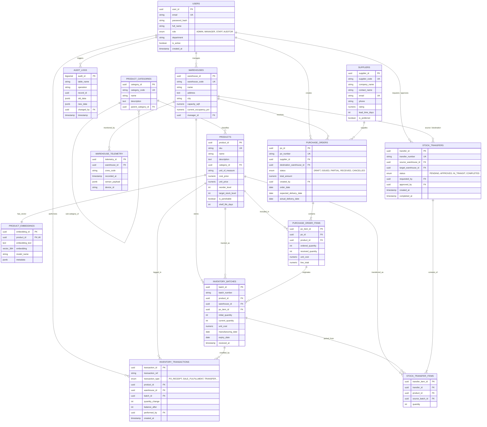

# Entity-Relationship (ER) Diagram
## Smart Inventory Management System (SIMS)
**Course:** DBMS Experiential Learning – Level 3 Project  
**Institution:** PES University  

---

### 1. Conceptual ER Model (Mermaid Diagram)

---

### 2. Entity Identification & Semantic Cardinalities

| Relationship | Entities Involved | Cardinality | Semantic Business Rule |
| :--- | :--- | :--- | :--- |
| **Warehouse Management** | `USERS` to `WAREHOUSES` | `1 : N` (Optional) | A manager can oversee multiple warehouses; a warehouse has at most one designated manager. |
| **Category Hierarchy** | `PRODUCT_CATEGORIES` (Self) | `1 : N` (Optional) | A parent category can have multiple subcategories (e.g., Electronics -> Microcontrollers). |
| **Product Classification** | `PRODUCT_CATEGORIES` to `PRODUCTS` | `1 : N` (Mandatory) | Every product must strictly belong to exactly one product category. |
| **Product Semantic Embeddings** | `PRODUCTS` to `PRODUCT_EMBEDDINGS` | `1 : 1` (Mandatory) | Every product has exactly one dense vector embedding for cosine similarity search. |
| **Procurement Orders** | `SUPPLIERS` to `PURCHASE_ORDERS` | `1 : N` | A supplier supplies zero or many purchase orders. |
| **PO Line Items** | `PURCHASE_ORDERS` to `PURCHASE_ORDER_ITEMS` | `1 : N` (Mandatory) | A PO must have at least one line item. Cascade delete on PO removal. |
| **Batch Tracking** | `PRODUCTS` to `INVENTORY_BATCHES` | `1 : N` | A single product can exist in multiple distinct batches across different warehouses. |
| **Double-Entry Ledger** | `INVENTORY_BATCHES` to `INVENTORY_TRANSACTIONS` | `1 : N` | Every physical stock movement generates an immutable, non-deletable audit ledger entry. |
| **Inter-Warehouse Transfer** | `WAREHOUSES` to `STOCK_TRANSFERS` | `1 : N` | Each transfer has distinct source and target warehouses (`source <> target`). |
| **IoT Telemetry (NoSQL)** | `WAREHOUSES` to `WAREHOUSE_TELEMETRY` | `1 : N` | High-frequency IoT sensory payloads are stored as semi-structured JSONB documents. |
| **Change Data Capture** | `SYSTEM` to `AUDIT_LOGS` | `1 : N` | Row-level triggers intercept all DML mutations into an append-only compliance log. |
